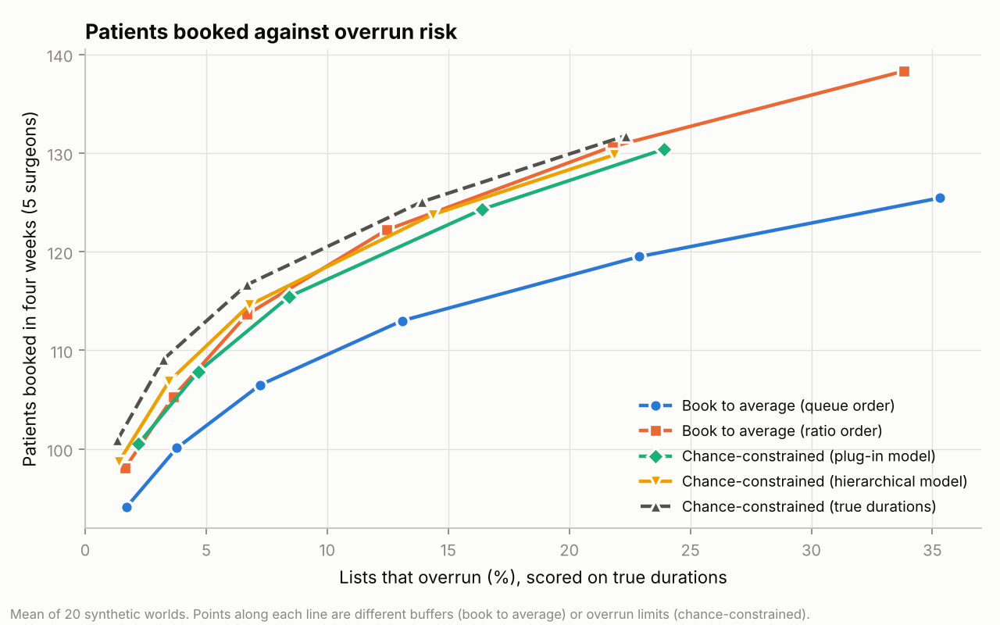
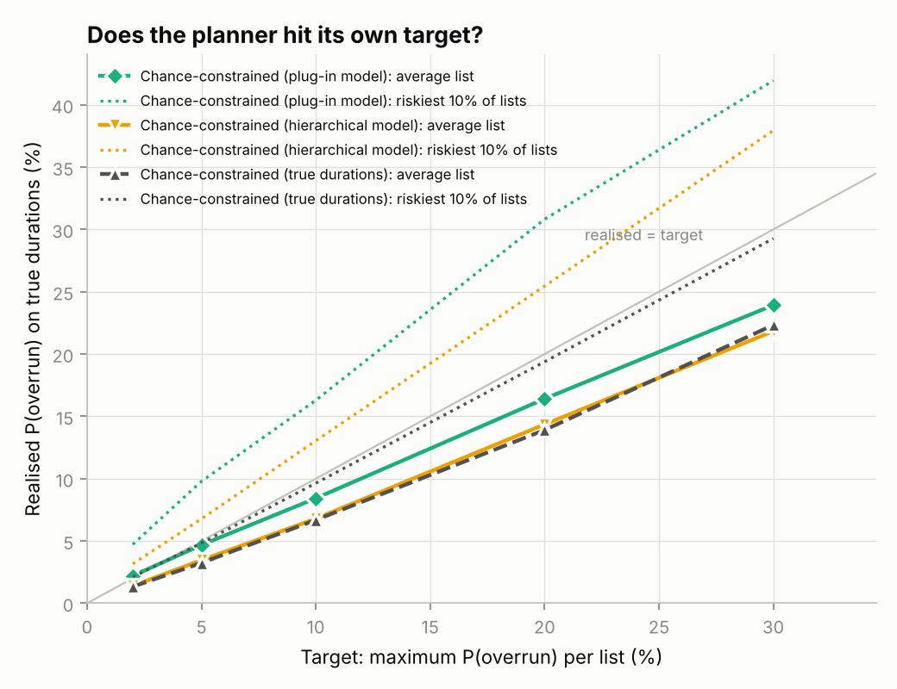
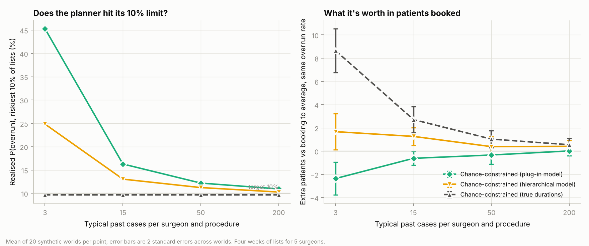
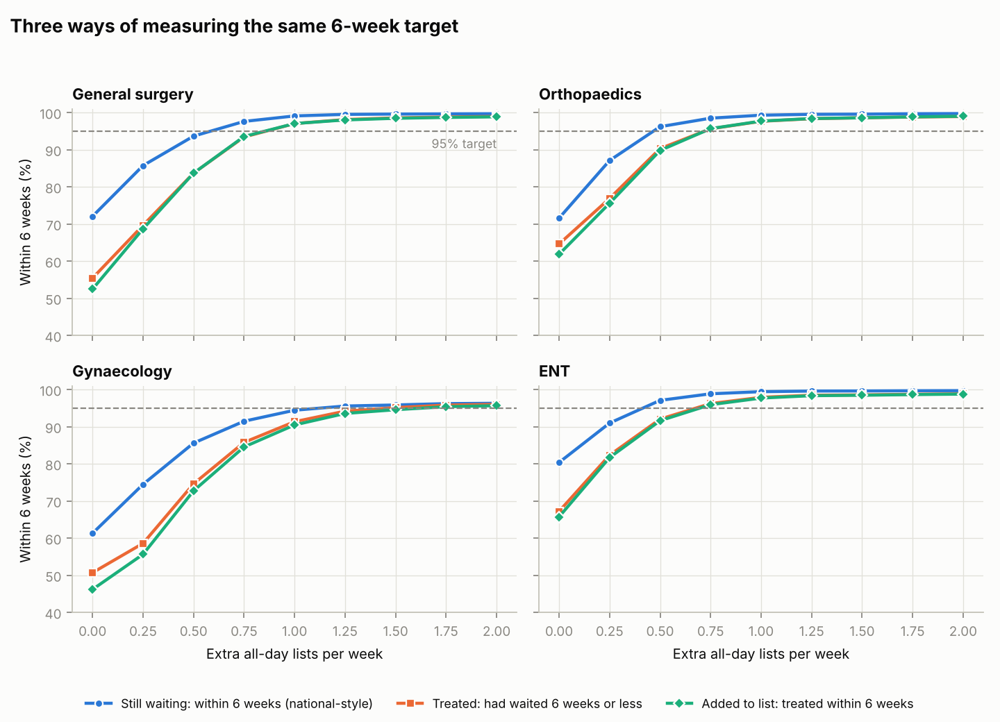
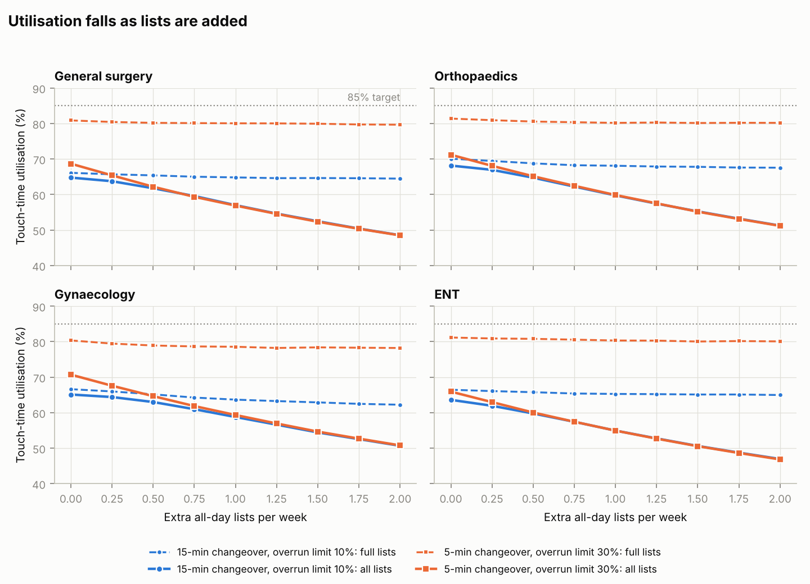
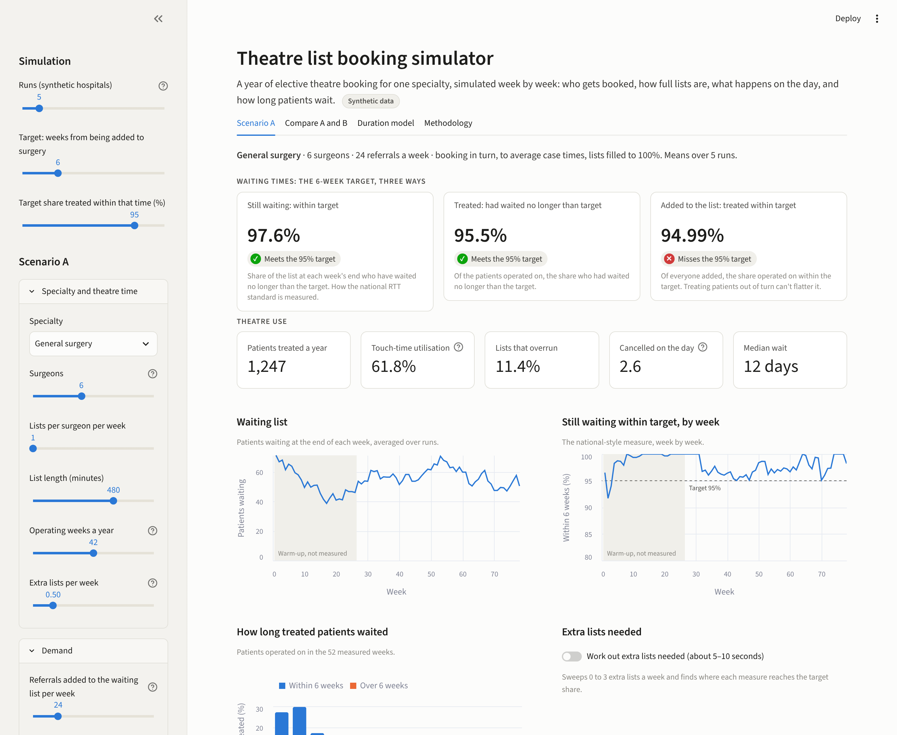
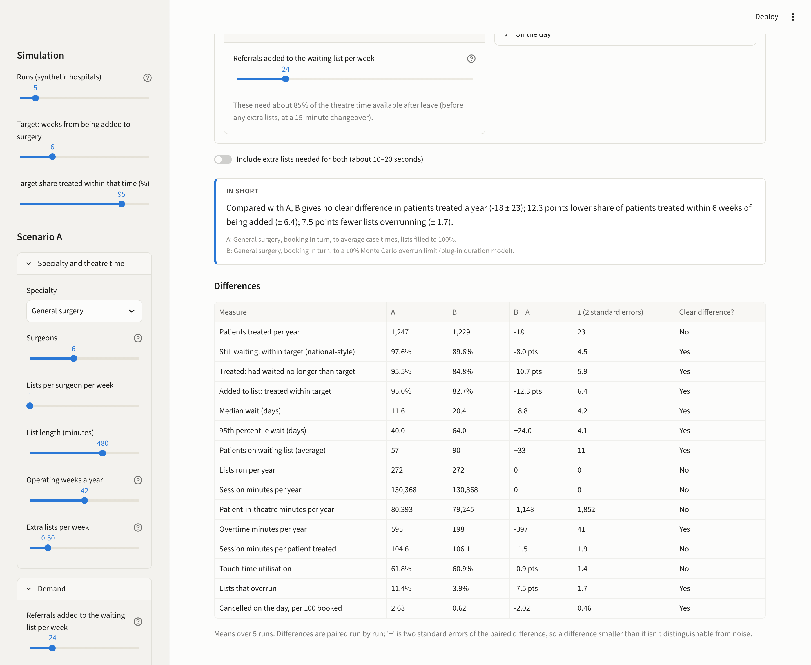
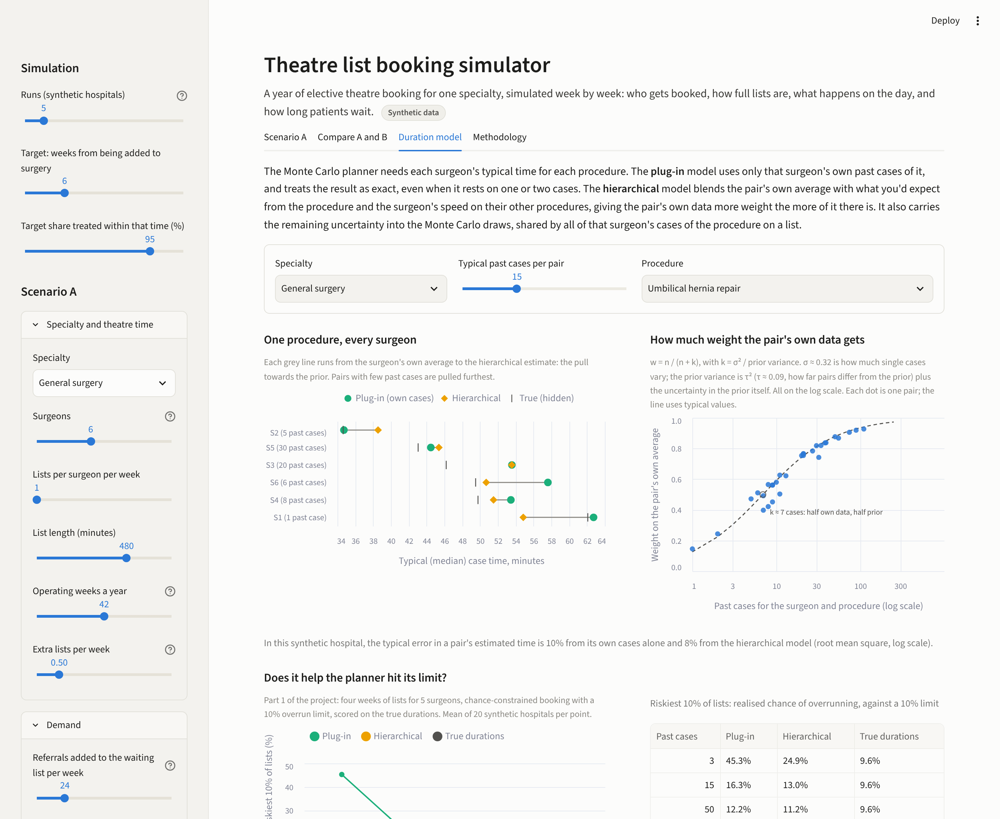

# Theatre list booking under uncertain case durations

Booking elective theatre lists means choosing which patients from a waiting list go on each surgeon's sessions. Case times are uncertain and skewed (most cases come in near the usual time, a few take much longer), so lists booked to average times often overrun, which means overtime or patients cancelled on the day.

The project has two parts:

- **[Part 1](#part-1-one-booking-window): one four-week booking window.** How many more patients can be booked, at the same risk of overrunning, if each case's uncertainty is modelled explicitly with Monte Carlo simulation rather than booking to average times? What does that gain depend on? And does a **hierarchical (partial pooling) duration model** help the planner keep its overrun risk where it means to?
- **[Part 2](#part-2-a-year-of-booking-in-four-specialties): a year of booking in four specialties.** How many extra lists does each specialty need to treat 95% of patients within 6 weeks of being added to the waiting list? How does the answer change with the way that target is measured? And what happens to the 85% theatre utilisation target?
- **[Part 3](#part-3-dashboard-and-scenario-comparison): a dashboard and scenario comparison.** A Streamlit app where every setting can be changed (demand, operating weeks, changeovers, booking rules and more), and two scenarios can be compared head to head. For example: how many patients, lists or theatre minutes separate optimised booking from first come, first served?

**Live dashboard:** [jackcormacwright-theatresceduler.streamlit.app](https://jackcormacwright-theatresceduler.streamlit.app/)

**All data here is synthetic.** See [Provenance](#provenance).

**Full methodology**, covering every formula, assumption and check with worked examples: [docs/METHODOLOGY.md](docs/METHODOLOGY.md). The same page is the *Methodology* tab in the dashboard.

# Part 1: one booking window

## Findings

These come from 20 synthetic worlds, each with 5 surgeons, 300 patients and four weeks of all-day lists. Every schedule is scored against the true duration distributions, which no planner sees.

1. **Which patients fill the spare space matters most.** Filling spare capacity with the patients who give the most priority per expected theatre minute, rather than taking them in the usual queue order, books about **6–14 more patients in four weeks at the same overrun rate** (out of roughly 100–140). That gain comes from choosing shorter cases: long cases fall from about 27% of bookings to 20–25%, so those patients wait longer. That is a clinical and policy decision, not a free gain.
2. **Modelling each case's uncertainty adds little on top, and only with good duration estimates.** With the true durations, the chance-constrained planner books about 4 more patients than a flat buffer at a 5% overrun rate, falling to under 1 at 30%. With durations estimated from the history (a median of 15 past cases per surgeon–procedure pair), it books slightly *fewer* (0.4–1.5) than the flat buffer.
3. **With realistic amounts of history, the planner misses its own target.** It is told to keep every list at or below a 5% chance of overrunning. On average it does (4.7%), but the riskiest tenth of its lists overrun about 10% of the time or more. At a 10% target, they overrun 16% or more. Its risk is spread no more evenly than a flat buffer's.
4. **The shortfall comes from small samples, not from the search.** Give the planner 200 past cases per pair and it matches the true-durations planner (riskiest tenth of lists at 5.4% against 4.8%, for a 5% target).
5. **A hierarchical duration model closes about half the gap.** Estimating each surgeon–procedure time partly from the rest of the data (the procedure's typical time and the surgeon's speed on other procedures), and carrying the remaining uncertainty into the Monte Carlo draws, brings the riskiest tenth of lists from 16.3% to 13.0% at a 10% target (the true durations give 9.6%). At the same overrun rate it books 1.3 more patients than booking to average (± 0.8), where the plug-in planner books 0.6 fewer. It matters most when history is thin: with a typical 3 past cases per pair, the plug-in planner's riskiest lists overrun 45% of the time against a 10% target, and the hierarchical planner's 25%. With 200 cases the three planners converge.

So the duration model, not the optimiser, is what limits the planner, and partial pooling is a cheap improvement.



At roughly a 7% overrun rate (means over 20 worlds; full table in [`results/summary.md`](results/summary.md)):

| Method | Setting | Patients booked | Lists overrunning | Riskiest 10% of lists | Long cases |
|---|---|---|---|---|---|
| Book to average, queue order | 15% buffer | 106.5 | 7.2% | ≥13.5% | 27.5% |
| Book to average, ratio order | 15% buffer | 113.7 | 6.7% | ≥13.4% | 23.3% |
| Chance-constrained, plug-in model | target 10% | 115.5 | 8.4% | ≥16.3% | 22.9% |
| Chance-constrained, hierarchical model | target 10% | 114.6 | 6.8% | ≥13.0% | 23.0% |
| Chance-constrained, true durations | target 10% | 116.7 | 6.7% | ≥9.6% | 22.6% |



### How much history the planner needs

[`scripts/run_history_sweep.py`](scripts/run_history_sweep.py) reruns the comparison with a typical 3, 15, 50 and 200 past cases per surgeon–procedure pair, holding everything else fixed, at a 10% overrun limit (20 worlds each; full table in [`results/history_sweep.md`](results/history_sweep.md)):

| Past cases per pair | Riskiest 10% of lists: plug-in | hierarchical | true durations | Extra patients vs booking to average: plug-in | hierarchical |
|---|---|---|---|---|---|
| 3 | 45.3% | 24.9% | 9.6% | −2.4 ± 1.4 | +1.7 ± 1.6 |
| 15 | 16.3% | 13.0% | 9.6% | −0.6 ± 0.6 | +1.3 ± 0.8 |
| 50 | 12.2% | 11.2% | 9.6% | −0.3 ± 0.8 | +0.4 ± 0.9 |
| 200 | 10.9% | 10.3% | 9.6% | 0.0 ± 0.4 | +0.4 ± 0.5 |

Extra patients are at the same overrun rate as booking to average in ratio order, ± two standard errors across worlds.



## The model

### The world ([`synthetic.py`](src/theatre_sched/synthetic.py))

- **Procedures.** Six elective general-surgery procedures, from skin lesion excision (median 25 min) to incisional hernia repair (median 110 min). The values are illustrative.
- **Case durations.** Lognormal: log(duration) ~ Normal(μ, σ²). μ combines the procedure's typical time, the surgeon's speed and a small surgeon-specific deviation for that procedure.
- **History.** Each surgeon–procedure pair has a varying number of past cases (median 15, from 1–2 up to 100+). Some estimates rest on very little data.
- **Waiting list.** Patients are assigned clinical priorities P2–P4 with assumed targets of 28, 90 and 180 days, and days already waited.
- **Sessions.** One 8-hour list per surgeon per week, with 15 minutes of turnaround between cases.

### What a booking is worth ([`schedule.py`](src/theatre_sched/schedule.py))

```
urgency = days waited / target days
weight  = 1 + λ · urgency          (λ = 1 by default)
```

The 1 rewards booking anyone at all, and the urgency term rewards booking people who have waited long relative to their target. Every P2 patient, and anyone at or past their target, is *must-book*: they are placed first, most urgent first. The methods differ in how they fill the remaining space.

### Duration models ([`durations.py`](src/theatre_sched/durations.py))

- **Plug-in.** Estimate μ and σ for each surgeon–procedure pair from its own history, then treat the estimates as exact. Pairs with fewer than 3 cases borrow the procedure's pooled σ. This is what a planner could realistically do.
- **Hierarchical.** Each pair's estimate is a weighted average of its own average and a prior (the procedure's typical time, adjusted for the surgeon's speed on their other procedures), with weight n / (n + k) on its own n cases. k, the number of cases at which the two get equal weight, is estimated from how much pairs differ beyond what the prior explains. The remaining uncertainty in each pair's average is drawn once per Monte Carlo draw and shared by all that pair's patients, so a surgeon who is slower than the data suggest is slower on every case. Fitted by empirical Bayes (method of moments), with no MCMC. [Methodology, section 3.1](docs/METHODOLOGY.md) has the formulas and a worked example.
- **Truth.** The world's real parameters, used to score schedules and as an oracle planner.

### Booking methods

- **Book to average.** Assume each case takes its surgeon's historical average, and fill each list up to a fraction of its length (100% means book to the end; 85% leaves a 15% buffer). Spare space is filled in either *queue order* (priority, then longest wait) or *ratio order* (most weight per expected minute).
- **Chance-constrained.** Draw 2,000 Monte Carlo samples of every patient's case time from the duration model. A list is allowed only if the share of draws in which it overruns is at most α. The search is greedy (must-book first, then ratio order, earliest list that fits), followed by improving swaps. All candidate lists are scored on the same draws, so comparisons between them aren't distorted by simulation noise.

### Scoring ([`evaluate.py`](src/theatre_sched/evaluate.py))

Each schedule is scored on 20,000 fresh draws from the **true** distributions. The reported measures are:

- patients booked;
- the share of lists that overrun;
- the 90th percentile of per-list overrun risk;
- expected overtime;
- utilisation, both counting changeovers as used time and as *touch time* (patient in theatre, capped at the session end, changeovers excluded: how the national 85% target is defined);
- the share of long cases;
- must-book patients left unbooked.

Comparisons "at the same overrun rate" interpolate the book-to-average curve within each world, then average over worlds (see `results/matched_risk.csv`, which includes standard errors).

## Limitations

- **The data is synthetic, so the results speak to mechanisms rather than magnitudes.** Real case-time distributions, surgeon variation and history sizes will move the numbers.
- **The model covers one four-week horizon with no new referrals.** It therefore can't measure the main cost of ratio ordering: long-case patients waiting longer over time.
- **Case durations are independent within a list.** In reality a slow start or a junior team affects the whole list, which makes overruns more likely than modelled here.
- **The constraint applies to every list.** With plenty of history (200 cases per pair), a flat buffer books about one more patient than the chance-constrained planner at overrun rates of 20% or more, even when the planner knows the true durations. The per-list guarantee probably costs some throughput compared with letting risk vary between lists.
- **The search is a heuristic.** It isn't guaranteed to be optimal and hasn't yet been benchmarked against an exact solver.
- **Several real constraints are left out:** case order within a list, on-the-day cancellation rules, emergencies, and anaesthetist, bed and equipment limits.

## Next steps for Part 1

1. **A fully Bayesian duration model.** The hierarchical model's intervals for pair averages are a little too narrow with sparse data (90% intervals contain the truth 80% of the time with 3 past cases per pair), because the fit treats the spreads σ and τ as known. MCMC would carry that uncertainty too, which may close more of the remaining calibration gap.
2. **Exact benchmark.** Solve the same sampled problem as an integer programme to measure how far the heuristic is from optimal.
3. **Case order within a list.** Test whether putting the more predictable cases first reduces overtime.


# Part 2: a year of booking in four specialties

Part 1 can't say anything about waiting times, because nobody new joins the list and nobody's wait grows. Part 2 simulates 78 weeks, booking week by week, for general surgery, orthopaedics, gynaecology and ENT.

The target used is **95% of patients treated within 6 weeks of being added to the waiting list**, as a working premise for meeting the 18-week referral-to-treatment (RTT) standard, which also has to cover the time before the decision to operate.

## How the target is measured changes the answer

The national RTT standard is measured on patients **still waiting**. Treating someone removes them from both the top and the bottom of the fraction. For example:

- 1,000 patients waiting, 920 of them within target: **92.0%**
- treat 50 who have waited 3 weeks: 870 / 950 = **91.6%**, so the measure gets worse
- treat 50 who have waited 30 weeks instead: 920 / 950 = **96.8%**

That's the same work, but the measure moves in opposite directions. So every run reports the 6-week target three ways:

| Measure | Question it answers | How it can mislead |
|---|---|---|
| **Still waiting** (national-style) | Of the patients on the list at the end of each week, what share have waited 6 weeks or less? | Holding patients who are still within target flatters it; treating them early counts against it |
| **Treated** | Of the patients operated on, what share had waited 6 weeks or less? | Treating short waiters flatters it; treating long waiters counts against it |
| **Added to list** (cohort) | Of the patients added to the list, what share were operated on within 6 weeks? | Nothing short of treating people within 6 weeks improves it |

## Findings

The results come from 10 synthetic worlds per specialty. Each has 6 surgeons operating 42 weeks a year, demand set at 85% of the session time available, and 52 measured weeks after a 26-week warm-up. Unless stated otherwise, the settings are: book in turn, 15-minute changeovers, and at most a 10% estimated chance of each list overrunning.

1. **The national-style measure says fewer lists are needed.** It reaches 95% with 0.25–0.5 fewer extra lists a week than the cohort measure in every specialty. That's 13–26 all-day lists a year per specialty. A trust sizing capacity on the national-style measure would under-provide.

   | Specialty | Extra all-day lists per week to reach 95%: still waiting | treated | added to list | Extra lists a year (added to list) |
   |---|---|---|---|---|
   | General surgery | 0.75 | 1.0 | 1.0 | 52 |
   | Orthopaedics | 0.5 | 0.75 | 0.75 | 39 |
   | Gynaecology | 1.25 | 1.5 | 1.75 | 91 |
   | ENT | 0.5 | 0.75 | 0.75 | 39 |

   The scenarios step in quarters of a list a week (13 lists a year), so each difference is at least one step.

2. **The national-style measure also struggles to tell booking policies apart, and can reward holding patients back.** With no extra lists, booking patients just before they would pass 6 weeks and filling the rest with long cases (`touch_fill`) raises the national-style measure by 3–5 points over booking in turn. Yet the share of new patients treated within 6 weeks is no better (0–3 points worse), and the median patient waits 3–6 days longer. Filling gaps with short cases instead (`ratio_fill`) keeps the national-style measure within about a point of booking in turn, but treats 5–10 points fewer new patients within 6 weeks. The reason is that a patient who is still within target counts in the measure's favour for as long as they wait.

3. **85% touch-time utilisation is out of reach here, and adding lists pushes it further away.** At the capacity that meets the cohort target, average touch-time utilisation is 53–62%. Between a quarter and over a third of lists (25–37%) run short of patients, because each list can only be filled from its own surgeon's waiting list. Even full lists reach only 63–68% with 15-minute changeovers, or about 80% with 5-minute changeovers and a 30% overrun limit. The absolute levels depend on this model's assumptions, so the finding is the direction: more lists means emptier lists.

4. **Faster changeovers and more willingness to overrun can stand in for extra lists.** With 5-minute changeovers and a 30% overrun limit, every specialty meets the cohort target with 0.25 extra lists a week, instead of 0.75–1.75. The cost is that 8.5–13% of lists overrun (against 3.5–4%) and 1.6–3.6 patients per 100 booked are cancelled on the day (against 0.6–1.2).

5. **Gynaecology needs the most extra capacity.** Its long, unpredictable laparoscopic cases force the most caution at a 10% overrun limit. At a 30% limit, it needs no more than the other specialties.





Policy comparisons are paired: the same patients, surgeons and leave in every scenario. Full tables are in [`results/capacity/summary.md`](results/capacity/summary.md), and per-run results with standard errors are in `results/capacity/`.

## The model ([`rolling.py`](src/theatre_sched/rolling.py))

- **Surgeons and lists.** Each specialty has 6 surgeons, each with one all-day list a week. Each surgeon takes 10 weeks of leave a year in two-week blocks, and patients belong to their own consultant.
- **Demand.** Poisson arrivals sized to 85% of the session time available after leave, at 15-minute changeovers. Every scenario sees exactly the same patients.
- **Booking.** At the start of each week, everyone added before that week can be booked. The policy sets the order, and each patient goes on the first of their surgeon's lists where the planner's estimated chance of overrunning stays within the limit. The planner uses the plug-in duration model from Part 1 (the dashboard can switch it to the hierarchical model or the true durations).
- **Extra lists.** These are Saturday lists, given each week to the working surgeons with the most patients about to pass 6 weeks.
- **On the day.** Cases run longest-expected first, using true durations. A case is cancelled if it's expected to finish more than 30 minutes after the session end. Cancelled patients go back on the list with their clock still running.
- **Policies.**
  - `in_turn`: urgent patients first, then longest wait.
  - `ratio_fill`: patients about to pass target first, then most priority per expected minute.
  - `touch_fill`: patients about to pass target first, then longest case.

## Limitations

- **There's no pooling.** Patients wait for their own consultant, which is the main reason lists run short. Pooled waiting lists are the obvious next scenario.
- **Demand is steady.** There's no seasonality, and no winter or bed pressure cancelling elective lists.
- **The planner never learns.** Its duration estimates aren't updated as cases build up.
- **Six weeks from being added to the list stands in for 18 weeks from referral.**
- **Utilisation levels depend on the assumptions:** what counts as case time, how long changeovers take, and whether anaesthetic rooms overlap (only the 5-minute scenario allows for that). Many real trusts report higher utilisation than this model.

## Next steps for Part 2

1. **Pooled lists.** Let any surgeon in the specialty take a patient (with that surgeon's duration distribution), and measure how many fewer lists are needed and how much fuller they run.
2. **Pressure.** Add seasonal demand and winter list cancellations.
3. **Templates.** Count the list compositions the booking produces (for example "two joints plus one short case") as candidate template lists.

# Part 3: dashboard and scenario comparison



[`app.py`](app.py) is a Streamlit dashboard over the Part 2 simulation.

- **Settings.** The sidebar holds every setting for scenario A:
  - specialty, number of surgeons, lists per surgeon and list length;
  - operating weeks a year and extra lists per week;
  - demand, as referrals a week for the whole specialty, shared between the surgeons, so adding surgeons adds capacity rather than demand;
  - how full lists are booked (to average times at a chosen fill %, or to a Monte Carlo overrun limit), and the Monte Carlo planner's duration model;
  - booking order and how much history the planner has;
  - changeover time and the on-the-day cancellation rule;
  - the target (weeks, and share of patients).
- **Scenario A tab.** The three waiting-time measures, each marked as meeting or missing the target, then utilisation, overruns and cancellations. It also charts the waiting list over time and how long treated patients waited, and can sweep extra lists to show how many each measure needs to reach the target.
- **Compare A and B tab.** B starts as a copy of A, and you change whatever you're testing. Both run on the same synthetic hospitals and, where the demand settings match, the same patients. The tab reports the paired difference B − A with ± two standard errors and flags whether each difference is clear of the noise. It covers:
  - patients treated a year, all three 6-week measures, median and 95th-percentile waits, and waiting list size;
  - lists, session minutes, patient-in-theatre minutes and overtime minutes a year, and session minutes per patient treated;
  - utilisation, overruns and cancellations;
  - optionally, the extra lists a year each scenario needs to reach the target.

  A one-paragraph summary says the result in words. **Match B's overrun rate to A's** retunes B's booking caution so the two are compared like for like.



- **Duration model tab.** Shows partial pooling at work in one synthetic hospital: for a chosen procedure, each surgeon's own average, the hierarchical estimate and the true time, and how the weight on a pair's own data grows with its number of past cases. It also charts the history sweep above.



In the year-long simulation, the better duration model mainly shows up as fewer overruns and on-the-day cancellations rather than shorter waits. In general surgery at 24 referrals a week and a 10% limit, lists overran 3.1% of the time against 3.9% with the plug-in model (10 runs; 4.8% against 5.8% with 3 past cases per pair). The differences in waiting times were within the noise, because at that demand the waits are set by capacity rather than by how cautiously lists are booked.

## First come, first served against optimised booking

[`scripts/run_differentials.py`](scripts/run_differentials.py) runs the comparison you'd make in the dashboard for all four specialties. It uses 10 runs each, at 0.5 extra lists a week, and pairs every comparison. **A** is first come, first served: book in turn, assume each case takes its surgeon's average time, and fill lists to 100%.

| Specialty | Monte Carlo, 10% limit: lists overrunning (pts) | cancelled per 100 booked | treated within 6 weeks of being added (pts) | extra lists a year to reach 95% | Monte Carlo, matched overrun rate: treated within 6 weeks (pts) | extra lists a year to reach 95% |
|---|---|---|---|---|---|---|
| General surgery | −8.4 ± 1.7 | −2.1 ± 0.4 | −14.5 ± 9.6 | +28 ± 8 | −0.3 ± 0.2 | +3 ± 2 |
| Orthopaedics | −8.3 ± 1.3 | −2.0 ± 0.5 | −8.1 ± 2.4 | +25 ± 3 | −0.1 ± 0.3 | −1 ± 1 |
| Gynaecology | −10.3 ± 2.0 | −4.0 ± 0.3 | −25.5 ± 10.9 | doesn't reach 95% within 3 a week | +0.2 ± 0.4 | −1 ± 1 |
| ENT | −9.7 ± 1.9 | −2.9 ± 0.2 | −5.9 ± 4.4 | +20 ± 5 | −0.2 ± 0.2 | 0 ± 1 |

Differences are B − A ± two standard errors. The full tables, including patients treated a year and a third comparison that also fills gaps with short cases, are in [`results/differentials/summary.md`](results/differentials/summary.md).

1. **At the same overrun rate, Monte Carlo booking is indistinguishable from first come, first served on averages.** Patients treated a year are within ±2. The share treated within 6 weeks is within 0.3 points, and the extra lists needed are within 3 a year. Filling gaps with short cases as well changes little: patients treated are within ±1 a year, and the share within 6 weeks within 0.3 points. This agrees with Part 1: with realistic amounts of history, modelling each case's uncertainty doesn't fit more patients in.
2. **The Monte Carlo's value is in choosing the trade-off deliberately.** Set to a 10% overrun limit, it cuts overrunning lists by 8–10 points and on-the-day cancellations by 2–4 per 100 booked. The price is 6–26 points fewer patients treated within 6 weeks at the same capacity, and 20–28 more extra lists a year to keep 95% within 6 weeks (gynaecology can't get there within 3 extra lists a week). Because it estimates each list's risk, a booking team could set that trade-off on purpose rather than discover it afterwards.
3. **"More cases" is capped by demand.** Once capacity exceeds demand, everyone is treated eventually. Better booking then shows up as shorter waits or fewer lists needed, not as more patients a year: in every matched comparison, the differences in patients treated are within the noise. The exception is booking so cautiously that a specialty falls short of capacity. Gynaecology at a 10% limit treats 28 fewer patients a year (± 22), and its waiting list grows.
4. **Part 2's list counts depend on how cautiously lists are booked.** Part 2 assumed Monte Carlo booking at a 10% limit and needed 39–91 extra lists a year. Booking to averages at 100% fill needs only 10–13, but 12–16% of its lists overrun. How much overrun risk a specialty accepts matters as much as its demand.

## Running the dashboard

```bash
pip install -e ".[app]"
streamlit run app.py
```

To deploy it on Streamlit Community Cloud:

1. Push the repo to GitHub as a public repository.
2. Sign in at share.streamlit.io with GitHub and create a new app.
3. Choose this repository, branch `main` and main file `app.py`, and pick a recent Python version (3.11 or later) in the advanced settings.

[`requirements.txt`](requirements.txt) installs the app's dependencies, and the app finds the `theatre_sched` package in `src/` itself. One simulated year takes about a tenth of a second. A scenario with 5 runs takes under a second, and a full extra-lists sweep takes 5–10 seconds per scenario. Results are cached, so returning to earlier settings is instant.

# Running it

```bash
python -m venv .venv && source .venv/bin/activate
pip install -e ".[dev]"
pytest                                   # 34 tests
python scripts/run_experiment.py         # Part 1: about a minute; writes results/
python scripts/run_experiment.py --history-cases 200 --out results/history200
python scripts/run_history_sweep.py      # Part 1 with 3, 15, 50 and 200 past cases per pair: about 4 minutes
python scripts/run_capacity.py           # Part 2: about 1.5 minutes on 2 cores; writes results/capacity/
python scripts/run_differentials.py      # Part 3: about 1.5 minutes on 2 cores; writes results/differentials/
streamlit run app.py                     # Part 3: the dashboard (needs pip install -e ".[app]")
```

# Layout

```
src/theatre_sched/
  synthetic.py    synthetic worlds: procedures for four specialties, surgeons, history, waiting list, sessions
  durations.py    lognormal duration models: plug-in fit, hierarchical (partial pooling) fit, true parameters
  evaluate.py     Monte Carlo scoring of lists and schedules, including touch-time utilisation
  schedule.py     Part 1: weights, book-to-average baselines, chance-constrained search
  rolling.py      Part 2: week-by-week simulation, booking rules and policies, the three 6-week measures
  scenarios.py    Part 3: run a scenario, paired A-vs-B comparison, lists-needed sweep, overrun matching
app.py                      Part 3: the Streamlit dashboard
requirements.txt            dependencies for Streamlit Community Cloud
.streamlit/config.toml      the dashboard's theme
scripts/run_experiment.py   Part 1 comparison across synthetic worlds, tables and figures
scripts/run_history_sweep.py  Part 1 planners against the amount of history per surgeon-procedure pair
scripts/run_capacity.py     Part 2 capacity scenarios by specialty, tables and figures
scripts/run_differentials.py  Part 3 first-come-first-served vs optimised booking, by specialty
docs/METHODOLOGY.md         full methodology (also the dashboard's Methodology tab)
docs/*.png                  dashboard screenshots
tests/                      checks on the evaluator, duration fit, schedulers, rolling simulation and world generator
results/                    output of the runs above (Part 2 in results/capacity/, Part 3 in results/differentials/)
```

# Provenance

I started a version of this while working as an NHS analyst, and it was deprioritised before it was finished. This repository is a from-scratch reimplementation on synthetic data. It contains no NHS code or data, and its parameter values are illustrative rather than taken from any organisation.

# Licence

MIT
